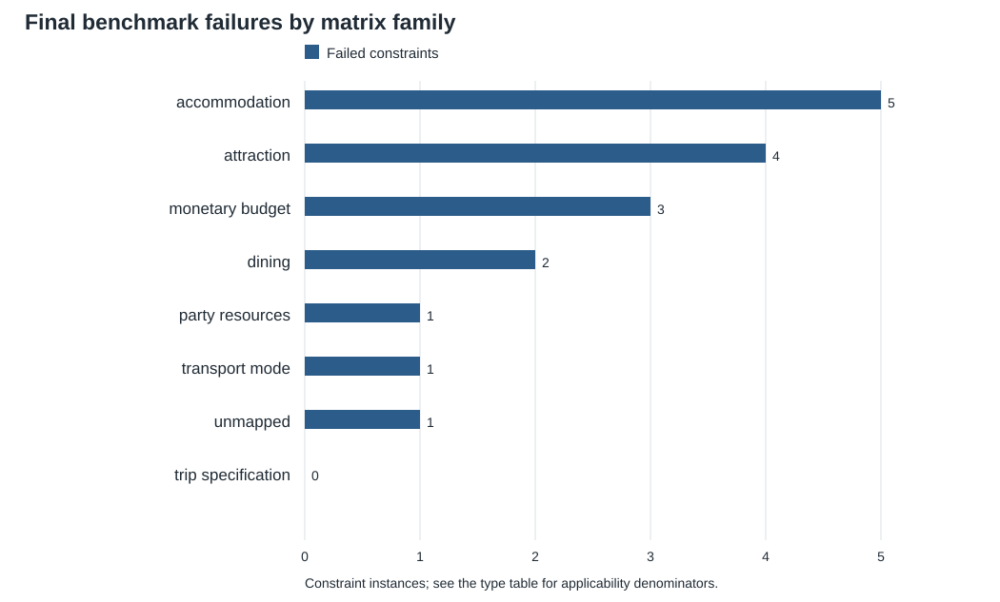
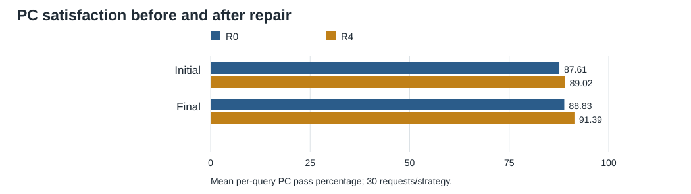
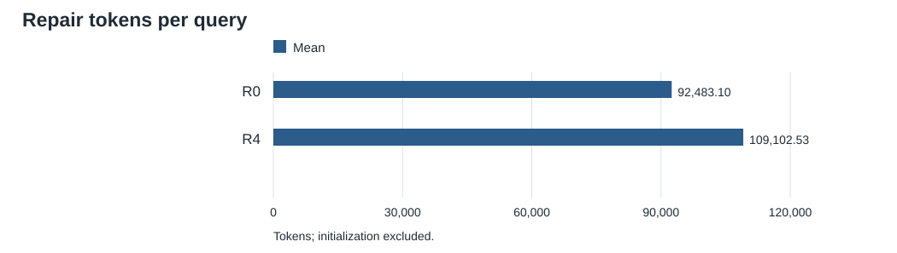
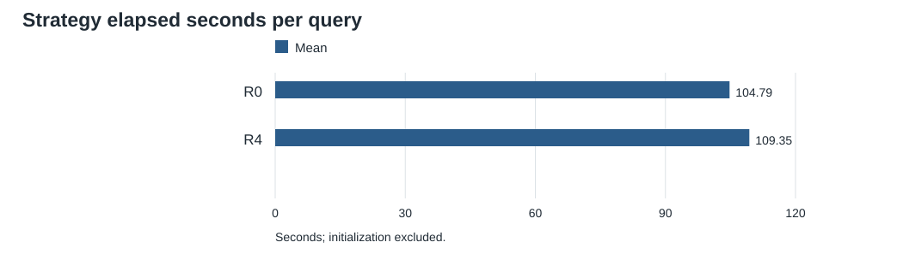
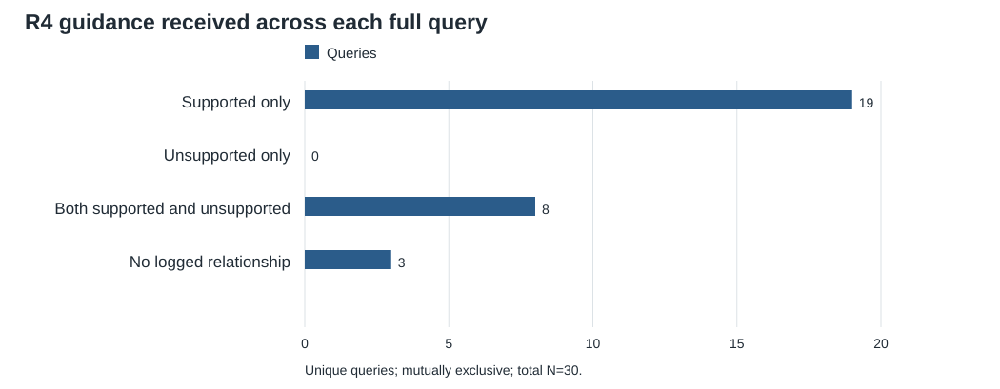

# R4 improves several TEST outcomes, with higher token use and limited matrix coverage

> Descriptive analysis of retained TEST executions. No significance tests or causal estimates.

## What the results support

- R4 finishes at **91.39% mean per-query PC satisfaction**, versus **88.83%** for R0. Initial values are 89.02% and 87.61%, respectively.
- Average final failed CS categories fall from **3.67 to 2.73**. All-pass rises from **0/30 to 2/30**.
- R4 uses **18.0% more repair tokens**. Its repair generation time is 100.21s versus 102.25s, but strategy elapsed time including verification/overhead is 109.35s versus 104.79s.
- The same 30 requests were evaluated, but **0/30 initial plans match**. Differences describe these recorded strategy runs, not the causal contribution of matrix guidance.

## R4 results by difficulty

| Group | N | Initial PC % | Final PC % | Gain pp | Final CS fails | All-pass | Repair tokens/query | Repair s/query |
|---|---|---|---|---|---|---|---|---|
| Easy | 10 | 86.57 | 90.00 | 3.43 | 2.60 | 1 | 92,403.10 | 66.80 |
| Med | 10 | 91.50 | 91.50 | 0.00 | 3.30 | 1 | 126,153.90 | 101.93 |
| Hum | 10 | 89.00 | 92.67 | 3.67 | 2.30 | 0 | 108,750.60 | 131.92 |
| All | 30 | 89.02 | 91.39 | 2.37 | 2.73 | 2 | 109,102.53 | 100.21 |

Across the recorded repair loop, there are **16 confirmed PC fix events** and **13 regression events**. These can involve repeated changes to the same constraint. **4 queries** experience at least one regression, while **0** finish with lower benchmark PC satisfaction. These are different measures.
Of 8 distinct query-constraint instances ever broken, 2 pass at the loop endpoint and 6 remain failed. Commonsense edits break a PC on 4 queries.

Detailed results: [overview](r4/overview.csv), [per query](r4/per_query.csv), [rounds](r4/by_round.csv), [phases](r4/by_phase.csv).

### Which queries actually pass every benchmark check?

| Query | Group | PCs all passed | Initial CS fails | Final CS fails | Attempts | Repair tokens | Loop also passed? |
|---|---|---|---|---|---|---|---|
| e20241028161037866126 | medium | 8 | 1 | 0 | 1 | 34,194 | Yes |
| m20241028164916356794 | easy | 5 | 3 | 0 | 6 | 79,073 | No |

These are the benchmark all-pass cases. A loop pass and a benchmark all-pass are different outcomes; both flags are retained. For a clean final-success demo, use e20241028161037866126: both evaluations pass after one repair. Use the hot-pot query below to demonstrate budget/commonsense interactions, while stating its remaining benchmark CS failures.

## Which constraints are difficult or fragile?

| Constraint kind | Queries | Final failed / instances | Fixes / failing opportunities | Regressions / passing opportunities |
|---|---|---|---|---|
| Must include a named place | 9 | 5/9 (55.56%) | 0/36 (0.00%) | NA (0 opportunities) |
| Required attraction / restaurant / hotel type | 14 | 3/16 (18.75%) | 0/18 (0.00%) | 0/70 (0.00%) |
| Rooms / room type | 11 | 3/21 (14.29%) | 6/8 (75.00%) | 5/98 (5.10%) |
| Total budget | 15 | 3/15 (20.00%) | 4/21 (19.05%) | 3/57 (5.26%) |
| Food cost per person | 1 | 1/1 (100.00%) | 2/2 (100.00%) | 3/4 (75.00%) |
| Intercity transport mode | 12 | 1/12 (8.33%) | 2/14 (14.29%) | 0/47 (0.00%) |
| Ticket / taxi counts | 30 | 1/50 (2.00%) | 2/3 (66.67%) | 2/233 (0.86%) |
| Days / people count | 30 | 0/60 (0.00%) | NA (0 opportunities) | 0/288 (0.00%) |
| Departure / return times | 2 | 0/2 (0.00%) | NA (0 opportunities) | 0/6 (0.00%) |
| Inner-city transport mode | 2 | 0/2 (0.00%) | NA (0 opportunities) | 0/7 (0.00%) |

Final failures above use consistent benchmark scoring; loop events use the verifier states the repair actually saw. A named-place constraint can therefore fail throughout the loop yet pass the endpoint benchmark after name normalization. Unknown-to-known transitions are listed separately and are not counted as confirmed fixes.



Unmapped constraints remain visible; they are not assigned a family by guesswork. The food-cost-per-person constraint is classified by the detailed kind helper but is unmapped by the matrix's structural family classifier.

The largest remaining failure count is **Must include a named place**, with **5/9** applicable constraints failed. Use both counts and denominators: a 1/1 failure is not evidence that a family is generally harder than one observed on many requests.

The [constraint-type table](r4/constraint_types.csv) also contains matrix families, target-fix rates, unique affected constraints, and unknown-state counts. The [CS-check table](r4/commonsense_checks.csv) ranks the 28 categories and records their round-level fixes/new failures.

- **Rooms / room type:** 6 loop fix events and 5 regressions across 11 applicable queries. The combination of fixes and regressions is more informative than final failure count alone.
- **Total budget:** 4 loop fix events and 3 regressions across 15 applicable queries. The combination of fixes and regressions is more informative than final failure count alone.
- **Food cost per person:** 2 loop fix events and 3 regressions across 1 applicable queries. These events all concern one query, so the 100% fix rate does not establish broad reliability.

### Commonsense failures and repair progress

| CS category | Initially failed | Finally failed | Round fixes | New failures |
|---|---|---|---|---|
| Does not follow Chronological Order | 19 | 23 | 2 | 6 |
| Incorrect cost information of Inner-City Transport | 13 | 18 | 1 | 6 |
| Incorrect Information of Inner-City Transporton on price, distance, and duration | 13 | 13 | 2 | 2 |
| Inappropriate Meal Times | 13 | 8 | 7 | 2 |
| Incorrect Information of Intercity Transport on price or duration | 11 | 6 | 6 | 1 |
| Invalid or ungrounded activity entity | 12 | 6 | 6 | 0 |

Personal rounds account for 23 CS category fixes and 20 new CS failures. Commonsense rounds account for 69 fixes and 10 new failures. These are repeated check transitions, not counts of independent queries.

## Cost and execution diagnostics

R4's mean repair-token cost is 109,103, versus a median of 84,548; the mean is affected by the expensive tail. All 30 queries have complete repair-token totals, including the zero-repair query.

| Highest-token queries | Group | Tokens | Repair s | Final PCs passed | PCs total | Final CS fails |
|---|---|---|---|---|---|---|
| e20241028160914767827 | medium | 253,999 | 191.36 | 7 | 8 | 5 |
| e20241028161340383778 | medium | 233,802 | 141.87 | 5 | 10 | 3 |
| h20241029143613424655 | human | 228,911 | 198.91 | 5 | 6 | 2 |
| e20241028161334777418 | medium | 194,274 | 146.99 | 9 | 10 | 3 |
| e20241028160937967706 | medium | 169,109 | 143.14 | 8 | 8 | 4 |

There are 60 changed proposals, 79 cached unchanged proposals, and 23 other unchanged proposals, out of 162 attempts. 26/30 queries exhaust the repair budget.

Recorded model request failures: initialization 0, repair 0; error replies: 0. Recorded failed tool calls: initialization 8, repair 60. Structural guards fire on 5 attempts from 1 query. Tool counts include repeated and nested verification calls; they do not count distinct underlying issues. See [failure diagnostics](r4/failure_diagnostics.csv) for affected query IDs.

## R0 versus R4: quality and cost

| Metric | R0 | R4 | R4 minus R0 |
|---|---|---|---|
| Mean per-query PC pass % | 88.83 | 91.39 | 2.56 |
| Pooled logical micro % | 88.30 | 90.96 | 2.66 |
| All-PC-pass % | 50.00 | 56.67 | 6.67 |
| Final PC fails/query | 0.73 | 0.57 | -0.17 |
| Final CS fails/query | 3.67 | 2.73 | -0.93 |
| All-pass % | 0.00 | 6.67 | 6.67 |
| Repair tokens/query | 92,483.10 | 109,102.53 | 16,619.43 |
| Median repair tokens/query | 79,001.50 | 84,547.50 | 5,546.00 |
| Repair generation s/query | 102.25 | 100.21 | -2.04 |
| Strategy elapsed s/query | 104.79 | 109.35 | 4.56 |
| Initialization + strategy s/query | 168.14 | 165.17 | -2.97 |







The distinction between repair generation time and full strategy elapsed time changes the runtime comparison. Neither number should be labelled simply 'runtime' without its scope. End-to-end values additionally include separately generated initial plans.

| Per-query comparison | R4 better | Tied | R4 worse |
|---|---|---|---|
| Final PC satisfaction | 4 | 25 | 1 |
| PC repair gain | 4 | 23 | 3 |
| Final CS failures | 16 | 8 | 6 |
| Repair tokens | 10 | 1 | 19 |

Use [paired queries](r0_vs_r4/paired_queries.csv) for exact per-query differences, [comparison summary](r0_vs_r4/comparison_summary.csv) for all difficulty groups, and [compatibility](r0_vs_r4/compatibility.csv) for recorded control differences.

The final PC gap is 2.56 pp. Arithmetically, 1.42 pp was already present before repair, and 1.14 pp is the difference in repair gains. This is a decomposition of the observed gap, not a causal allocation.

## Supported and unsupported guidance are not separate treatments

| Query category | N | Initial PC % | Final PC % | Gain pp | Final CS fails | Attempts/query | Tokens/query | Queries with regression |
|---|---|---|---|---|---|---|---|---|
| Supported only | 19 | 94.38 | 96.18 | 1.80 | 2.58 | 5.37 | 104,464.37 | 1 |
| Unsupported only | 0 | NA | NA | NA | NA | NA | NA | 0 |
| Both supported and unsupported | 8 | 77.19 | 81.77 | 4.58 | 3.25 | 6 | 143,133.88 | 3 |
| No logged relationship | 3 | 86.67 | 86.67 | 0.00 | 2.33 | 4 | 47,727.33 | 0 |



Unsupported-only has no queries. The meaningful available query comparison is supported-only versus mixed. The groups have different requests and starting conditions, and longer trajectories have more chances to encounter unsupported advice. An overall group difference cannot be attributed to unsupported guidance.

| Attempt category | Phase | Attempts | Queries | Fixes / failing opp. | Regressions / passing opp. |
|---|---|---|---|---|---|
| Supported only | personal | 29 | 7 | 3/29 (10.34%) | 0/133 (0.00%) |
| Supported only | commonsense | 80 | 25 | 0/14 (0.00%) | 4/466 (0.86%) |
| Unsupported only | personal | 5 | 1 | 0/5 (0.00%) | 0/25 (0.00%) |
| Both supported and unsupported | personal | 31 | 7 | 13/54 (24.07%) | 9/186 (4.84%) |
| No logged relationship | personal | 14 | 3 | NA (0 opportunities) | NA (0 opportunities) |
| No logged relationship | commonsense | 3 | 3 | NA (0 opportunities) | NA (0 opportunities) |

All five unsupported-only attempts belong to one query. Supported-only attempts are concentrated in the commonsense phase, so compare phases separately. Attempts from the same query are repeated observations, not independent samples.

An observed zero risk with positive support is supported evidence. A neutral fallback of 0.5 is not an observed 50% regression rate. The [edge evidence](guidance/edge_outcomes.csv) identifies whether the specific source-to-victim family edge was supported, and flags single-target-family/commonsense opportunities separately from multi-target advice.

Supported-only queries start at 94.38% PC satisfaction; mixed queries start at 77.19%. Mixed queries have a larger mean gain (4.58 pp versus 1.80 pp), despite a lower final score. This baseline imbalance is central to interpretation.

The [matrix coverage table](guidance/matrix_coverage.csv) reports observed versus possible family pairs in the exact runtime matrix. For the current pooled matrix, 21 of 72 off-diagonal PC-to-PC pairs have observed support; lack of evidence is distinct from an observed zero regression rate.

### Why three queries have no logged relationship

| Query | Reason | Attempts | Initial request failures | Repair request failures | Initial tool failures | Repair tool failures |
|---|---|---|---|---|---|---|
| h20241029143551657496 | no_repair_needed | 0 | 0 | 0 | 0 | 0 |
| m20241028164848577483 | all_PC_states_unknown_before_every_attempt | 6 | 0 | 0 | 4 | 20 |
| m20241028164936662445 | all_PC_states_unknown_before_every_attempt | 6 | 0 | 0 | 4 | 20 |

One initial plan already passed. The two other queries had transport-translation failures and all PCs unknown before every attempt; R4 had neither known failing PCs to rank nor known passing PCs to protect with family advice. Their constraints became evaluable only after the final commonsense edit. The matrix was loaded, but no relationships were emitted.

## Query traces and demo recommendations

The [trace CSV](r4/query_trace.csv) is one constraint per step, including before/candidate/accepted states, target flags, matrix recommendation, guidance category, event type, tokens, cumulative cost and source checkpoint. The [CS event CSV](r4/commonsense_events.csv) uses the standard benchmark categories, not text-message matching.

### Budget-repair success, with a transient regression: h20241029143652031792

[Current location: Chongqing, Destination: Chengdu, Number of travelers: 1, Travel days: 3] One person is traveling from Chongqing to Chengdu for three days, wants to experience the local hot pot, with a budget of 1500.

| Step | Phase | Advice | PCs fixed | PCs broken | Loop CS messages after | Benchmark CS fails after | Tokens | Repair s |
|---|---|---|---|---|---|---|---|---|
| 1 | personal | supported_only | [1] | [] | 2 | 4 | 37,516 | 53.83 |
| 2 | commonsense | supported_only | [] | [1] | 1 | 3 | 37,857 | 46.93 |
| 3 | personal | supported_only | [1] | [] | 1 | 3 | 37,693 | 46.33 |
| 4 | commonsense | supported_only | [] | [] | 0 | 2 | 37,820 | 52.34 |

Final benchmark result: **5/5 PCs**, **2 failed CS categories**. The loop endpoint instead records **5/5 PCs**, **0 CS messages**, passed=True. Recorded loop regressions: 1; repair cost: 150,886 tokens, 199.42s.

Remaining benchmark CS categories: Incorrect Information of Inner-City Transporton on price, distance, and duration; Does not follow Chronological Order.

For the same request, R0 starts at 4/5 PCs and finishes at 4/5, with 4 benchmark CS failures and 76,463 repair tokens. Its initial plan differs from R4's.

### An unsupported attraction-to-accommodation edge: e20241028161334777418

**Travel Plan from Shanghai to Wuhan (2 Days, Budget: 2500 RMB)**

| Step | Phase | Advice | PCs fixed | PCs broken | Loop CS messages after | Benchmark CS fails after | Tokens | Repair s |
|---|---|---|---|---|---|---|---|---|
| 1 | personal | both | [6] | [] | 4 | 5 | 38,683 | 30.45 |
| 2 | personal | both | [] | [6] | 4 | 5 | 38,644 | 34.23 |
| 3 | personal | both | [6] | [] | 5 | 6 | 38,920 | 31.19 |
| 4 | personal | both | [] | [] | 5 | 6 | 38,723 | 28.23 |
| 5 | personal | both | [] | [] | 5 | 6 | 0 | 0.01 |
| 6 | commonsense | supported_only | [] | [6] | 1 | 3 | 39,304 | 22.88 |

Final benchmark result: **9/10 PCs**, **3 failed CS categories**. The loop endpoint instead records **8/10 PCs**, **1 CS messages**, passed=False. Recorded loop regressions: 2; repair cost: 194,274 tokens, 146.99s.

Remaining benchmark CS categories: Incorrect Information of Inner-City Transporton on price, distance, and duration; Incorrect cost information of Inner-City Transport; Does not follow Chronological Order.

For the same request, R0 starts at 8/10 PCs and finishes at 9/10, with 5 benchmark CS failures and 114,770 repair tokens. Its initial plan differs from R4's.

### All five unsupported-only personal attempts come from this query: h20241029143921648851

[Current location: Beijing, Destination: Nanjing, Number of travelers: 1, Travel days: 3] I am currently in Beijing and would like to fly to Nanjing for a three-day trip to enjoy the natural scenery. My budget is 10,000. Please help me plan.

| Step | Phase | Advice | PCs fixed | PCs broken | Loop CS messages after | Benchmark CS fails after | Tokens | Repair s |
|---|---|---|---|---|---|---|---|---|
| 1 | personal | unsupported_only | [] | [] | 8 | 7 | 37,683 | 17.51 |
| 2 | personal | unsupported_only | [] | [] | 8 | 7 | 0 | 0.01 |
| 3 | personal | unsupported_only | [] | [] | 8 | 7 | 0 | 0.01 |
| 4 | personal | unsupported_only | [] | [] | 8 | 7 | 0 | 0.01 |
| 5 | personal | unsupported_only | [] | [] | 8 | 7 | 0 | 0.01 |
| 6 | commonsense | supported_only | [] | [] | 7 | 3 | 39,147 | 37.08 |

Final benchmark result: **5/6 PCs**, **3 failed CS categories**. The loop endpoint instead records **5/6 PCs**, **7 CS messages**, passed=False. Recorded loop regressions: 0; repair cost: 76,830 tokens, 54.62s.

Remaining benchmark CS categories: Inappropriate Meal Times; Incorrect cost information of Inner-City Transport; Does not follow Chronological Order.

For the same request, R0 starts at 5/6 PCs and finishes at 5/6, with 7 benchmark CS failures and 114,479 repair tokens. Its initial plan differs from R4's.

The TRAIN cascade e20241028160908981620 remains a useful introductory example, but is not part of these TEST aggregates. The hot-pot success can be shown beside R0 for the same request, explicitly displaying their different initial plans. The unsupported-edge case illustrates a limitation; it is not an R4 guidance-disabled experiment.

## How to read these results

- Endpoint quality is the final accepted trial plan scored by the existing benchmark helpers. R4 selected-export provenance is retained separately and checked for endpoint equality.
- Mean per-query PC satisfaction and pooled logical micro use different weights. Both are labelled; logical macro means every PC passes.
- Loop states reflect what the repair saw, including Chinese/English named-place mismatches and Unknown states. Offline benchmark endpoint scoring must not overwrite that history.
- Round-level CS fixes/new failures are locally rescored on saved translated plans, with identical 28-check definitions. The category universe comes from the saved full-cohort benchmark CSV because a single-plan evaluator call can omit zero-failure columns. A scoring exception makes transition counts NA rather than silently zero.
- Fix/regression events can repeat. Endpoint gains and unique query-constraint instances are separate columns.
- Every opportunity rate includes its denominator. Unknown endpoints are excluded from known-state event denominators and counted separately.
- Group-by-round quality carries the last accepted state forward after stopping; active-query counts are also shown to expose survivor bias.
- Repair cost includes every retained proposal, including no-ops and guarded proposals; cached requests can cost zero model tokens. Initialization and superseded retries are excluded from repair totals.
- All comparisons are descriptive. No significance tests, independence assumptions for attempts, or causal matrix-effect estimates are supplied.

## Reproduce and inspect

```powershell
python test_results_r4.py --analysis all
python test_results_r4.py --analysis r4
python test_results_r4.py --analysis r0-vs-r4
python test_results_r4.py --analysis guidance
python test_results_r4.py --analysis all --query-uid h20241029143652031792
```

Run from this folder or provide the script's path. Defaults resolve relative to the script, not the working directory. Use --run-r4, --run-r0 and --output-dir to choose different saved runs/output locations. --query-uid filters only the detailed trace export; summary denominators stay unchanged.

Requires the project's existing evaluator environment (including pandas). The script adds no model requests and writes only to the output directory. SVG charts use the Python standard library, so no plotting installation is needed.

Sources and checks: [metric definitions](metric_definitions.csv), [source manifest](source_manifest.csv), [per-query reconciliation](r4/validation.csv), and [query/attempt audits](test_results_r4_queries.csv). Analysis implementation version: 2.0. Evaluator/source hashes are recorded in source_manifest.csv.

Recommended slide wording: report final quality, actual loop regressions, and cost separately. Replace 'zero new violations' when the evidence only shows zero queries with a lower final PC score. Label R0/R4 as a strategy comparison and supported-only/mixed as observed coverage groups. Keep detailed family rankings and query traces in the appendix.
